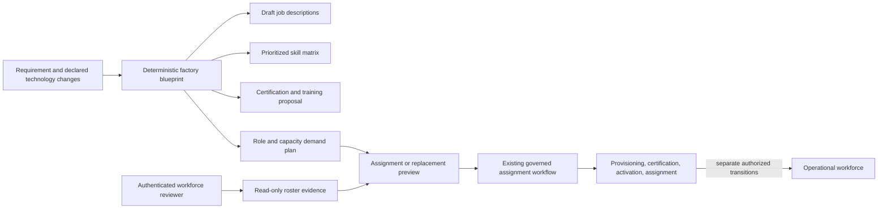

# Agent Factory and Workforce Director

## Architecture

The factory is a deterministic planning layer in `app/services/agent_factory.py`. Requirement creation now returns a non-persisted blueprint generated from its title/description, with technology suggestions limited to a bounded supported catalog. The Workforce Planning UI can also generate a blueprint with explicitly entered technology changes. It converts these inputs into team/role blueprints, original job-description sections, prioritized skill requirements, tool/integration suggestions, certification paths, and an upskilling plan. It does not call an LLM or create database records. Treat outputs as drafts for review, not approved role profiles.

The Workforce Director is represented as a bounded planning persona: monitor read-only workforce readiness, prepare blueprints, rank qualified candidates, and identify review needs. It has no authority to provision, activate, certify, assign, replace, revoke credentials, or retire agents.

## Lifecycle

The application lifecycle remains requirement intake, workforce request, authorized recruiting decision, non-active provisioning, approved model configuration, evidence-backed skill and evaluation review, authorized activation, qualified assignment, monitored work, and separately reviewed deactivation/retirement. The factory does not bypass any transition. Assignment and replacement previews are read-only and preserve the existing governed assignment route as the only way to change task assignments.

Retirement is not automated. An inactivity or expiry signal alone is not sufficient to retire an agent; active assignments/executions, credentials, permissions, retention, audit obligations, and accountable approval must be checked. Current database evidence does not establish a general obsolescence policy, so the dashboard reports retirement candidates as unavailable instead of inventing them.

## Generated artifacts

- Job descriptions include purpose, responsibilities, skills, experience, success metrics, KPIs, certifications, reporting structure, and tools.
- Skill entries are grouped as Technical, Domain, AI, Security, or Governance with a priority from 1 to 5. Technology-change inputs propose JD, skill, certification, and training updates; approved role profiles are not mutated.
- Certification tiers (Bronze, Silver, Gold, Platinum) are proposed training/evaluation paths. They do not issue certifications. Existing current Capability, Safety, Security, and Governance evaluations remain the execution-readiness gate.
- Assignment scores weight skill match 35%, certification match 25%, availability 15%, capacity 15%, project experience 5%, and performance 5%. Skill, all required evaluations, availability, and capacity are hard eligibility gates. Missing performance evidence is excluded and reported, not fabricated. The score is a ranking aid, not authorization.
- Replacement uses the same candidate ranking while excluding the unavailable agent. It does not transfer work or carry approvals automatically.

## APIs

All factory APIs require `WORKFORCE_MANAGER` or `PLATFORM_OWNER`; they use the existing single-organization workforce evidence boundary.

| API | Behavior |
| --- | --- |
| `POST /workforce/factory/blueprint` | Deterministic role/JD/skill/certification/upskilling blueprint and nine-artifact `technical_delivery_package`; no database access or writes. |
| `POST /workforce/factory/agent-lifecycle-plan` | Returns simulated agent profiles, skill/certification paths, lifecycle gates, upskilling, unverified assignment/replacement recommendations, and governance; no records are created and authority remains NONE. |
| `POST /workforce/factory/assignment-plan` | Scores optional caller-supplied candidate claims against planned work and returns capacity, skill-gap, replacement, readiness, and Workforce Director views; all claims remain unverified and no assignments occur. |
| `POST /workforce/factory/code-package` | Returns a JSON file map for allowlisted .NET, Python, or Node.js backend source plus database, OpenAPI, frontend, security, test, and DevOps assets; no server filesystem writes, code execution, image builds, infrastructure creation, or deployment. |
| `POST /requirements` | Also returns transient `workforce_blueprint` and `technical_delivery_package` outputs in the creation response; no package persistence or additional lifecycle action. |
| `GET /workforce/factory/dashboard` | Read-only roster metrics with explicit denominators and readiness basis. |
| `POST /workforce/factory/assignment-preview` | Ranks active, non-executive candidates using live role, skill, evaluation, capacity, and completed-project evidence. |
| `POST /workforce/factory/replacement-preview` | Same ranking while excluding the unavailable agent. |

Existing `/workforce/requests/*`, `/workforce/agents/*`, `/workforce/reuse-assessments/*`, and `/workforce/projects/*/plan` remain governed mutation routes. The factory never calls them automatically.

## Dashboard measures

- Certification coverage: active agents with no missing current Capability, Safety, Security, or Governance evaluation divided by active agents.
- Skill coverage: distinct required role skills with at least one currently available qualified agent divided by distinct required role skills.
- Capacity utilization: mean recorded `CurrentWorkload` among active agents.
- Workforce readiness: active agents with no recorded role-skill or required-evaluation gaps and a configured provider/model/version divided by all registered agents. This is a conservative operational indicator, not authorization or a certification decision.
- Empty denominators are returned as `null` and rendered as unavailable. Historical performance normalization is not configured in the current assignment preview; prior completed-project count is reported as a ranking input.

## Verification and limits

`tests/test_agent_factory.py` covers generated artifacts, hard assignment gates, candidate exclusion, dashboard denominators, and no-write behavior. The full project test suite remains the release check. Current system readiness is determined from the live dashboard endpoint after an authorized session is established; no static or generated blueprint can supply a live readiness percentage.

Agent record creation, skill changes, certification, activation, assignment, replacement, credential revocation, and retirement remain separate governed decisions. To move toward any future automation, first establish an approved autonomy policy, identity/tenant scope, idempotent audit records, independent authorization, rollback/compensation, incident handling, and negative tests for each lifecycle transition.