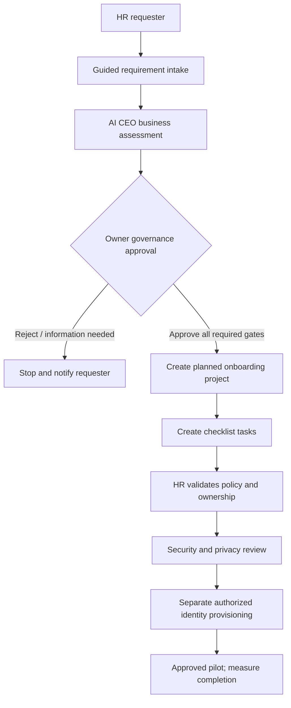

# HR Onboarding Workflow Pilot

**Status:** Local synthetic demo requirement was assessed and explicitly approved by Super Admin on 2026-10-23. The live database now contains one Planned project and seven Planned tasks. This authorizes planning only: no employee records, account provisioning, employee notifications, integration, or deployment. The assessment provider is deterministic demo logic, not a production AI model.

## Request Summary

**Title:** HR onboarding pilot - local workflow demo  
**Priority:** High  
**Current requirement status:** Approved  
**AI CEO assessment:** Human Resources; High complexity; High risk; Feasible with conditions; confidence 72  
**Approval:** `CEO_REVIEW` approved by an authorized Super Admin with a recorded reason  
**Project/tasks:** One `Planned` project and seven `Planned` tasks; no execution is active  
**Employee data:** Synthetic requirement text only; no actual employee records used
**Current staffing:** 0/3 assessed skills have an active qualified agent; 0/7 tasks are assigned. The only active agent is AI CEO.
**Workforce requests:** Six role requests were authorized for recruiting with reason “Proceed with hiring.” The current local database now has six linked Agent records in `Provisioning`: Delivery Lead, Business Analyst, Software Developer, QA Engineer, Security Engineer, and HR Workforce Coordinator. They are not Active and have no task assignments.
**Agent readiness:** All six have `UNCONFIGURED` provider/model values and Pending AgentSkill links. Capability and Safety evaluations are absent. Activation API returns `409` until these prerequisites exist.
**Activation blocker state:** Each of the six HR agents has open provider, model-version, and missing-evaluation blockers recorded in `AgentActivationBlocker`; Owner/Super Admin were notified. The current policy requires passed Capability, Safety, Security, and Governance evaluations plus an explicit Owner/Super Admin activation decision. No task assignment or activation has occurred.
**Company org bootstrap:** Completed from the approved Super Admin decision: 56 roles, 49 Agent records created, 7 existing agents reused, 55 role agents remain in `Provisioning`, one pre-existing AI CEO remains Active, and all reporting parents resolve. This is company-wide and idempotent; it did not activate agents or assign HR tasks.
The six HR project workforce requests are linked to the matching company-wide role Agent in `Provisioning`. This connects future configured/evaluated activation to the project requisition without creating duplicate role agents.
**Effort estimate:** 80 assessed skill-hours, equivalent to 10 person-days at an illustrative 8-hour/person-day assumption. Four task roles have no persisted effort estimate, so this is not a complete delivery estimate. It excludes wait time, review, parallelism, and capacity; no calendar dates are committed.

### Business need and desired outcome

HR onboarding is coordinated through email and spreadsheets, which can result in missed steps and inconsistent first-day readiness. The proposed outcome is an auditable onboarding checklist with named owners, due dates, and progress visibility. A pilot target is 95% checklist completion by each employee's start date.

### Proposed scope

- Initiate a checklist only after an authorized hire is confirmed.
- Coordinate equipment, orientation, policy acknowledgements, required training, and requests to existing IT identity processes.
- Give HR a request-level overview, managers access to their assigned new hires, and IT access only to provisioning tasks.
- Escalate overdue checklist tasks to their assigned human owners.
- Do not automatically create accounts, decide employment status, send employee communications, or deploy integrations.

### Data minimization and controls

Use only work name, work email, department, manager, start date, and checklist status when necessary. Exclude passwords, payroll, banking, health information, and identity documents. Require role-based access, audit history, an approved retention schedule, and human confirmation before any identity provisioning or employee notification.

### Open decisions before solution design

1. Which HRIS is the authoritative source of hire/start-date data?
2. Which identity provider and approved provisioning API are in scope?
3. Which jurisdictions and employment/privacy requirements apply?
4. What retention and deletion schedule is approved?
5. What is the pilot cohort, region, and named HR accountable owner?
6. Which notification channels are approved, and what data may each contain?
7. Which exact roles may see employee-level versus aggregate onboarding status?

## HR Pilot Decision Register

The following are recommended defaults, not approved policy. A real pilot is blocked until the named business/policy owners record the decisions and the controls are implemented and tested.

| Decision | Recommended default | Accountable sign-off | Current state / gate |
| --- | --- | --- | --- |
| HRIS system of record | Use the organization's existing HRIS as the sole source for confirmed hire, department, manager, and start date. Do not introduce a second employee master. | HR Operations owner and HRIS service owner | Open; identify the system and authorize a read-only integration before pilot. |
| Identity provider and provisioning | Use the existing enterprise IdP and approved IT service workflow. Keep this app request-only; no direct account creation or privilege changes. | IAM/IT service owner and Security | Open; integration remains disabled until threat review, least-privilege design, and a human provisioning gate pass. |
| Jurisdiction | Limit the first real pilot to one explicitly named country/site already approved for the chosen hosting and data flows. Exclude cross-border hires until Privacy/Legal approves the transfer and local requirements. | Privacy/Legal and HR owner | Open; no real employee data until jurisdiction and data residency are signed off. |
| Retention and deletion | Do not persist raw chat turns. Retain only the minimum structured checklist fields while active; propose deletion 90 days after checklist closure, subject to statutory and audit-retention requirements. Keep security/audit evidence separately under the approved corporate schedule. | Privacy/Legal and Records Management | Open; 90 days is a proposal, not a configured or approved retention rule. Define deletion, backup expiry, legal hold, and audit exceptions. |
| Pilot owner and cohort | Name one HR Operations lead as accountable service owner, with a named HR process operator and IT/IAM and Security contacts. Start with a small, single-site cohort only after the above gates; no cohort size or site is approved yet. | HR executive sponsor / HR Operations | Open; record named individuals, deputies, decision rights, and escalation route before pilot. |
| Employee communications | Use only the authenticated in-app inbox for governance notices; do not contact employees from this app during the pilot. | HR owner, Privacy, and Communications | Open; no email/SMS/push channel until message content, lawful basis/consent, and opt-out are reviewed. |
| Employee-level access | HR owner and assigned HR operators see the required checklist; managers see only assigned hires; IT sees only its provisioning tasks; executives get aggregate status by default. | HR data owner and Security | Open; implement assignment-based authorization and test denial paths before importing employee data. |

**Go/no-go rule:** Until each `Open` item has a named approver, recorded decision, and verified implementation evidence, restrict demonstrations to synthetic data. Approval of the requirement above is approval to plan the workflow, not approval of these policy decisions or a real-employee pilot.

## AI CEO Assessment Contract

The current deterministic provider classifies this HR pattern and returns HR, Technology, Cybersecurity, and PMO recommendations. It flags unauthorized provisioning as Critical risk and requires human approval. Fixed/demo output remains advisory and must not be treated as a validated model opinion.

### CEO system prompt for a future governed model

> You are the AI CEO business-assessment agent in a governed enterprise workflow. Assess whether the proposed HR employee-onboarding workflow aligns with approved business strategy, improves measurable onboarding readiness, and has a clear accountable business owner. Separate requester-provided facts, assumptions, and unresolved decisions. Identify business impact, strategic fit, priority recommendation, organizational dependencies, and business risks. Pay special attention to employee privacy, access boundaries, hiring authority, identity provisioning, jurisdiction, retention, and employee communications. Do not infer legal compliance or claim that controls exist unless evidence is provided. Recommend human review for high/critical risk or unresolved governance controls. Do not make architecture, budget, employment, security-authorization, or delivery decisions. Do not approve, activate, provision, notify employees, or execute tools. Return schema-validated structured output with evidence references, confidence, assumptions, open questions, risks, and a human-review requirement. Only authorized people and workflow policies may approve work.

### Required CEO output questions

- Is an accountable HR business owner identified?
- Is the measurable onboarding outcome clear and testable?
- Are the requester and affected groups represented?
- Are HRIS, identity provider, jurisdiction, retention, pilot cohort, and notification scope resolved?
- Is the employee-data minimum defined, and are excluded sensitive categories explicit?
- Are provisioning, access changes, and employee communications blocked until authorized approval?
- What risks or open decisions require Owner, Security, Privacy, Legal, or HR approval?

## Workflow and Approval State

1. The synthetic local demo requirement was created under the authenticated Super Admin's identity.
2. The deterministic CEO assessment was persisted as assessment version 1 with High risk and `HumanApprovalRequired=true`.
3. One `CEO_REVIEW` approval and a governance notification were created.
4. An authorized Super Admin approved the synthetic planning request with a recorded reason; the requirement is now `Approved`.
5. The final approval created one `Planned` project and seven `Planned` tasks. It did not provision accounts, notify employees, or deploy.
6. Rollback-only tests continue to cover rejection and request-information paths; both block project creation.
7. A separate legacy FSQA request was found in `PendingApproval` with no Approval row. It had persisted assessment evidence requiring human review; it was reconciled by creating one assigned `Pending` approval. Its status remains `PendingApproval` with no project, and it was not approved.
8. Six HR-project workforce requisitions were authorized for recruiting with recorded reason “Proceed with hiring.” Approval automatically created six non-active Agent records in `Provisioning`, each with role-derived Pending skill links.
9. Activation was attempted as a negative QA check and correctly blocked: no approved model/provider/version is configured and no passed Capability or Safety evaluations exist. No project lead or task assignments were made.
10. The approved recruiting requests were automatically provisioned into six non-active Agent records. Work remains blocked at activation; provisioning is not execution.

## Delivery Lead And Workforce Lifecycle

The additive migration `sql/07_delivery_workforce_planning.sql` installs original role profiles and corresponding Position rows for Delivery Lead, HR Workforce Coordinator, Business Analyst, Software Developer, QA Engineer, Database Administrator, Data Engineer, Data Analyst, and Security Engineer. These are reusable baseline job descriptions written for this product; they are not copied from employer postings and require local HR/legal review before publication.

After project creation, the planner sequences task templates, tags each task with its required role, and attaches finish-to-start dependencies. It matches only `Active`, non-executive agents whose `AgentSkill` records meet every minimum proficiency and whose concurrency/workload permits another assignment. No match creates one idempotent workforce requisition per project/role and notifies Owner/Super Admin reviewers. The Workforce Center allows an Owner/Super Admin to approve recruiting or reject with a reason. Approving recruiting does not create or activate an agent.

An authorized recruiting approval now automatically creates an Agent row in `Provisioning` with a linked Position and Pending required skills. It does not set model/provider credentials or mark skills verified. Before activation, an authorized operator must configure the approved provider/version and record passed Capability and Safety evaluations. Owner/Super Admin activation then promotes skills and Agent to Active; the workforce planner assigns only qualified available agents and attaches the Delivery Lead to the project. Task start also requires completed prerequisites.

Task completion currently remains a reasoned, human-recorded workflow transition; the application has no model invocation/execution worker, isolated code-edit/test environment, or tool authorization runtime. Therefore it cannot yet autonomously write and test code or complete a task. Do not mark a task Completed to simulate an agent working. Implement the sandboxed execution worker, artifact/checkpoint model, test harness, independent QA, approval handoffs, failure/retry policy, and release gates before enabling autonomous development.

AI agent creation, provider credentials, model/prompt approval, tool permissions, independent safety evaluation, human HR hiring, employment/background checks, and activation are separate controlled processes. The system must not scrape or copy every global employer's job descriptions, auto-hire a human, or activate a new AI agent from a project approval.

## Target Data and Delivery Design

Reuse existing `Requirement`, `RequirementAssessment`, `RequirementAssessmentDepartment`, `RequirementSkill`, `Approval`, `Project`, `Task`, `TaskAssignment`, and `AuditLog` tables. Before a production HR rollout, add/confirm company ownership and employee/manager relationships, employee-to-skill and assignment models as needed, configurable workflow stages, durable notification preferences, and data-retention metadata.

## Security and Privacy Gates

- Require authenticated HR identity and company/tenant scope on every request, approval, employee, and task query.
- Managers must only access assigned direct reports; department membership alone is insufficient authorization.
- Do not collect passwords, bank/payroll, health, government ID, or identity-document data in the onboarding brief or notifications.
- Keep system-of-record data and access provisioning behind explicitly authorized, auditable integrations.
- Do not notify a person about a hire until HR confirms the communication and timing gate.
- Require Owner approval for high-impact policy/budget exceptions and explicit Security/Privacy/Legal review based on jurisdiction and data classification.
- Store notification bodies as minimal metadata; keep sensitive employee details behind the authorized request view.
- Test tenant isolation, manager-team boundaries, rejected approval blocking, idempotent retries, and audit completeness before production.

## QA Result and Blockers

The end-to-end workflow passed rollback-only database QA with the deterministic HR-specific demo branch. Approval, rejection, request-information, multiple-approval gating, idempotent planned project creation, and seven planned tasks were exercised with synthetic transactions. The actual HR demo was then explicitly approved by the user through the authenticated Approval Center; its resulting one Planned project and seven Planned tasks are real local demo records, not rolled-back test data. The tracker now labels this state Project planning and shows the persisted skill-effort estimate and active-agent coverage. It intentionally does not assign the sole active AI CEO to implementation work or invent calendar dates.

The legacy demo provider's original hard-coded supplier output was a confirmed defect and has been replaced with a deterministic HR-specific branch. Remaining blockers before a real HR pilot are decisions and sign-offs in the register, governed model/provider evaluation if model-based advice is required, verified tenant and manager scope for employee records, retention implementation, notification policy, configurable approval stages, and separate authorized provisioning/deployment gates.
