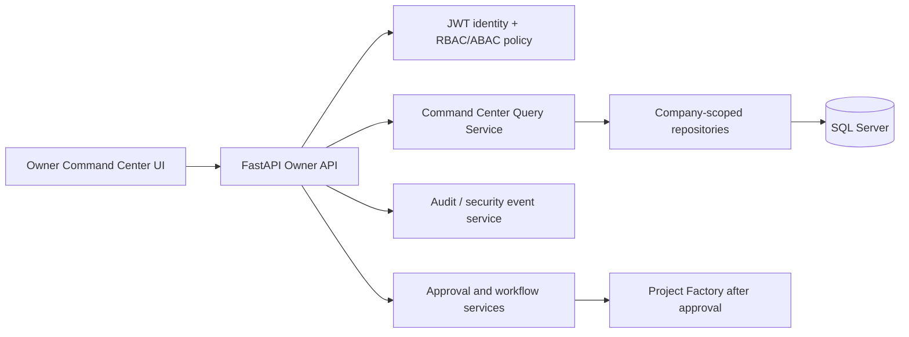
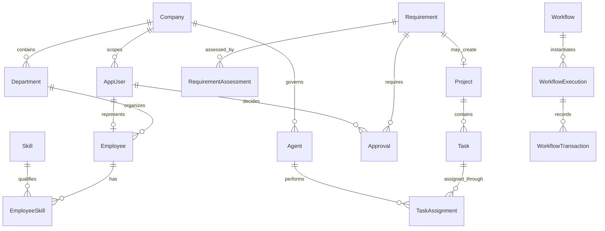

# Owner Executive Command Center

**Status:** UI design prototype and implementation blueprint. The prototype uses illustrative sample data and is not an authenticated Owner experience.

## Functional Design

The Owner Command Center is a company-scoped operational summary for the Owner / Super Admin. It provides executive visibility and routes decisions to governed workflows; it is not a substitute for source-of-record project, workforce, or approval screens.

The first release should provide:

- Organization KPIs: users, employees, agents, active projects, open high risks, pending approvals, and overdue tasks.
- Delivery health: project status, milestone progress, approved and consumed budget, risks, and overdue work.
- Governance queue: approval type, requesting actor, affected company/project/agent, risk, age, SLA due time, and evidence links.
- Workforce capacity: available, allocated, and forecast capacity by department and skill; utilization and availability should be time-bounded and explainable.
- Agent operations: status, queue depth, in-flight work, success/error rate, cost against limits, and last evaluation.
- Escalations: critical requirement, security, policy, budget, and delivery events requiring a named decision owner.

The prototype is at `/static/owner-command-center.html`. Its sample-data disclosure must remain until every displayed metric is backed by the authorized API. It must not be used as evidence that Owner authorization or live operational metrics exist.

## Existing Architecture And Extension Point

The application currently uses FastAPI routers, SQLAlchemy sessions, SQL Server, and static HTML/CSS/JavaScript served from `app/static`. Existing code includes `Company`, `Department`, `AppUser`, `Role`, `Agent`, `Requirement`, `RequirementAssessment`, `Approval`, `Project`, `Task`, `TaskAssignment`, `Workflow`, `WorkflowExecution`, and `AuditLog` concepts in the schema or models. Dashboard counts are currently exposed by `/dashboard/api` to authenticated users; the current token path assigns the `USER` role and is not an Owner authorization implementation.

The production command center should be a read-only aggregation service behind a dedicated Owner API. It should compose existing repositories/services, not place cross-domain SQL and authorization rules in browser code. All aggregation queries must be scoped to the authenticated user's active company membership before returning data.

## Database Design

Reuse existing tables where their semantics and tenant ownership are verified. Do not duplicate `Project`, `Approval`, `Agent`, or `AuditLog` solely to support dashboard cards.

| Entity | Role in the command center | Implementation status |
| --- | --- | --- |
| `Company` | Tenant and data-isolation boundary | Present in base SQL schema |
| `Department` | Company organization and capacity grouping | Present in base SQL schema |
| `AppUser`, `Role` | Human identity and role assignment | Present; Owner enforcement/bootstrap needs hardening |
| `Employee` | Workforce profile, manager, employment status, capacity | Not present as a dedicated table |
| `Skill`, `EmployeeSkill` | Skill catalog and employee proficiency/availability | `Skill` present; `EmployeeSkill` missing |
| `Agent`, `AgentSkill`, `AgentTool`, `AgentPermission` | Agent registry and governed capabilities | Present in base SQL schema; runtime telemetry is incomplete |
| `AgentCapability` | Versioned capability contract and allowed operation classes | Missing; distinguish this from skills and tool permissions |
| `Requirement`, `RequirementAssessment` | Intake, assessment evidence, risk and recommendations | Present in current schema/migration |
| `Approval` | Decision request, approver, status, timestamps, evidence reference | Present, but model/API versions are inconsistent and need reconciliation |
| `Project`, `Task`, `TaskAssignment`, `Risk`, `Budget` | Delivery, allocation, risk, and financial measures | Present in base SQL schema; service workflows are incomplete |
| `Workflow`, `WorkflowExecution` | Versioned workflow definition and execution state | Present in base SQL schema |
| `WorkflowStage`, `WorkflowTransaction` | Stage-level assignment, SLA, transition and decision history | Missing; add if execution JSON cannot provide normalized auditability |
| `Notification` | Durable user notification and delivery status | Missing |
| `AuditLog` | Append-only actor/action/resource/outcome evidence | Present; standardize event payload and retention controls |

### Key relationships

All tenant-owned records need a consistent `CompanyID` path or a verifiable relationship to one. Add foreign keys, unique constraints, status checks, UTC timestamps, and indexes supporting company/time/status dashboard filters. Use idempotent SQL Server migrations. Never derive a tenant boundary from a client-supplied company ID alone.

## APIs

The endpoints below are target contracts, not currently implemented routes.

| Method and route | Purpose | Access |
| --- | --- | --- |
| `GET /owner/command-center` | Bounded KPI summary and reporting window | Owner / Super Admin, company-scoped |
| `GET /owner/portfolio` | Paginated project health, budget, milestone, and risk data | Owner / authorized executive, company-scoped |
| `GET /owner/approvals` | Paginated pending queue with age, SLA, risk, and evidence references | Owner / assigned approver, company-scoped |
| `POST /owner/approvals/{approval_id}/decision` | Approve, reject, or request information with reason and expected version | Assigned authorized approver; Owner required for governance-critical classes |
| `GET /owner/workforce/capacity` | Capacity/utilization by department, skill, and date window | Owner / authorized workforce role, company-scoped |
| `GET /owner/agents/operations` | Agent status, queue, cost, reliability, and evaluation freshness | Owner / AI governance role, company-scoped |
| `GET /owner/escalations` | Open critical exceptions and SLA breaches | Owner / authorized executive, company-scoped |

Dashboard responses should include `as_of_utc`, reporting window, company identity, metric values, source/definition metadata, and freshness or partial-data indicators. Use pagination for lists, stable sorting, bounded date windows, Pydantic response schemas, and query timeouts. Avoid returning secrets, prompt contents, raw personal data, or unrestricted audit payloads in summary responses.

## Workflow And Approval Logic

1. A business user submits a requirement. The authenticated actor, tenant, correlation ID, and initial state are recorded by the API, never accepted as trusted identity fields from the request body.
2. The assessment workflow invokes CEO assessment and records versioned structured output, assumptions, evidence, confidence, risks, and model/prompt versions.
3. CTO, CFO, and COO assessments are separate attributable workflow steps with bounded inputs/outputs. Each may recommend; none can grant its own approval.
4. Policy evaluation determines required human approval. High-risk/security, policy, budget exception, organization, agent lifecycle, project-priority, and critical escalation decisions require Owner approval.
5. The approval is assigned to a verified approver and receives an SLA. Decisions require a reason, actor authorization, current record version, and immutable audit event.
6. Only after all required approvals pass does the workflow transition to `Approved` and invoke project generation. Rejection or information requests stop downstream creation and retain the full history.
7. Project Factory creates the project, milestones, tasks, dependencies, and proposed assignments idempotently using the approved assessment version. Human/agent execution starts only after explicit authorization and policy checks.
8. Every transition records actor, correlation ID, previous/next state, timestamp, evidence reference/hash, and outcome. Retries must not duplicate approvals, projects, tasks, or assignments.

The dashboard decision action must call the API; hiding controls in the UI is not authorization. Enforce valid state transitions and approval authority on the server.

## Security And Compliance Controls

- Validate JWT signature, issuer, audience, expiry, and revocation/session state. Do not trust role or company claims without server-side membership and policy checks.
- Enforce RBAC plus ABAC for tenant, resource ownership, risk class, approval type, and delegated authority. Default deny. The Owner role must be provisioned through a controlled bootstrap process, not public registration.
- Before production integration, replace the hard-coded JWT signing secret with managed configuration, hash passwords with a modern password hashing function, and reconcile duplicate auth implementations.
- Protect mutations with least privilege, request validation, idempotency keys, optimistic concurrency, rate limits, and explicit audit events. Require MFA/step-up authentication for governance-critical approvals and security/policy changes.
- Apply company isolation in every repository query and verify it with cross-tenant negative tests. The frontend is not a security boundary.
- Minimize personal data in charts, restrict drill-downs, redact sensitive audit fields, define retention, and protect exports with authorization and audit logging.
- Do not expose prompt instructions, credentials, tokens, hidden chain-of-thought, or raw model/provider responses. Preserve only approved structured rationale and evidence.
- Add security logging and alerting for failed authorization, unusual exports, role changes, approval overrides, agent permission changes, and tenant-boundary violations.

## Dashboard Components

1. **Company header:** active company context, reporting period, as-of timestamp, and authenticated Owner identity.
2. **KPI strip:** users, employees, agents, projects, risks, approvals, and overdue tasks; click-throughs preserve company/date filters.
3. **Portfolio health:** status distribution and a paginated project table with delivery, budget, risk, and milestone indicators.
4. **Governance queue:** urgency-sorted approval list with aging/SLA, request type, risk, and explicit decision entry point.
5. **Workforce utilization:** capacity and availability by department/skill, with definitions and date window visible.
6. **Agent operations:** status, queue depth, success/error rates, cost limits, and evaluation recency.
7. **Escalation strip:** only actionable high-severity items, with owner, due time, and direct link to evidence.
8. **Data quality states:** loading, unavailable, stale, partial, empty, and permission denied. Never substitute illustrative values in production.

The current prototype presents the component hierarchy and visual treatment but uses sample metrics, lists, and chart values. It is not connected to `/dashboard/api` or the database.

## AI Agent Prompt Contracts

All role prompts should require structured, schema-validated outputs and explicitly prohibit execution or approval. Store versioned prompts and model metadata; evaluate outputs against known cases. Include only authorized, minimized context.

- **AI CEO:** return business impact, strategic fit, priority recommendation, affected stakeholders, business risks, assumptions, evidence references, confidence, and whether human review is required.
- **AI CTO:** return architecture options, integration/security/data concerns, complexity, dependencies, technology rationale, risks/mitigations, assumptions, evidence, and confidence. Do not approve security policy exceptions.
- **AI CFO:** return estimate range, cost drivers, ROI assumptions, budget fit, financial risks, sensitivity, evidence, and confidence. Do not authorize spending or budget exceptions.
- **AI COO:** return milestones, dependency-aware timeline range, capacity/skill demand, delivery risks, and operating readiness. Do not assign real staff or activate work before approval.

Common system instruction: “You are an advisory agent in a governed enterprise workflow. Do not claim a decision has been approved. Do not execute tools or change records. Separate evidence from assumptions, identify missing information, use the provided output schema, and recommend human review when risk or confidence thresholds require it.”

## Implementation Plan

1. **Security and identity foundation:** consolidate auth paths, hash passwords, externalize JWT secrets, establish controlled Owner bootstrap, validate company membership, and add backend role/policy dependencies. Add negative authorization tests before exposing Owner data.
2. **Schema and migration reconciliation:** compare SQLAlchemy models with deployed SQL Server schemas; resolve `Approval`/`Project` mismatches; add missing employee, skill-link, capability, workflow-stage/transaction, and notification entities only where required. Keep migrations idempotent and tenant-aware.
3. **Governed workflow services:** implement approval state transitions, decision reason/version checks, audit events, SLA/escalation behavior, and idempotent project-factory invocation after approval.
4. **Owner read APIs:** build company-scoped repositories and response contracts with definitions, freshness, pagination, and bounded queries. Add tests for role, tenant, date range, empty data, stale/partial data, and performance.
5. **Production UI integration:** replace prototype sample data with API responses; add loading/error/empty states, filters, accessible tables, and authorized drill-down links. Remove the design-preview banner only after all metrics and role checks are live.
6. **Operational readiness:** test migration/rollback in a non-production database, verify audit retention and backups, load-test aggregates, review accessibility, and complete security/privacy sign-off before enabling Owner actions.
