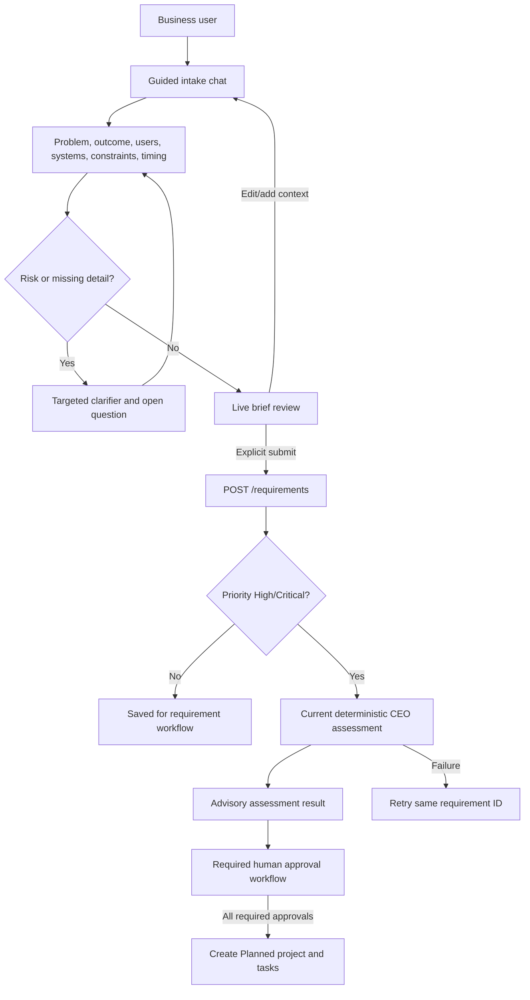
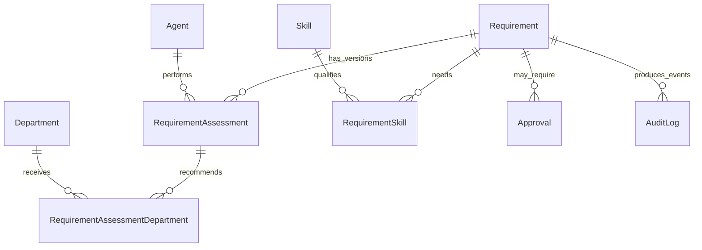

# Requirement Management And Conversational Intake

**Status:** Guided UI is implemented as an MVP; CEO follow-up behavior is scripted and the assessment provider is deterministic. This document distinguishes that behavior from the governed production target.

## Functional Design

Business users describe the need through a one-question-at-a-time conversation instead of completing a long form. The UI collects the business problem, desired outcome, affected users/stakeholders, systems and data, constraints/security, timing/dependencies, optional clarifications, and final context. A live brief summarizes the answers. The user chooses Low, Medium, High, or Critical priority and reviews the brief before explicit submission.

Conditional clarification rules in the MVP identify integration terms and personal/sensitive-data terms. The future AI-assisted provider should ask focused, contextual clarifiers for missing acceptance criteria, data ownership, integration direction, privacy/security obligations, deadlines, dependencies, and measurable outcomes. Unknown answers are recorded as open questions, not invented facts.

Priority is the requester's urgency signal. It is not the AI risk rating, approval state, budget authorization, or permission to start delivery.

## Current Implementation

- Page: `app/static/requirement-chat.html`
- Styles: `app/static/requirement-chat.css`
- Browser flow and API calls: `app/static/requirement-chat.js`
- Landing-page entry: `/static/requirement-chat.html`
- Requirement create endpoint: `POST /requirements`
- Supervised approval preview: `POST /workforce/factory/approval-sandbox`
- Assessment endpoint: `POST /requirements/{requirement_id}/assess`
- Authenticated request tracker: `GET /requests` and `GET /requirements/{requirement_id}/tracking`
- Existing tables: `Requirement`, `RequirementAssessment`, `RequirementAssessmentDepartment`, `RequirementSkill`, `Agent`, `AuditLog`
- Database stores the assembled labeled description after submission; draft turns are browser-only and are not separately persisted.
- High/Critical requests are saved first and then automatically sent to the currently wired deterministic assessment endpoint. If assessment fails, the saved requirement remains and the UI offers retry using its existing ID.
- The deterministic provider returns fixed demo data; this is not a model that interprets each user answer. Conditional intake questions are simple keyword rules.
- The tracker advances only from persisted assessment, approval, project, and audit evidence. It reports approval-required-but-unassigned and approved-without-project states explicitly.
- Human-review-required assessments create an assigned `CEO_REVIEW` approval and durable in-app notifications for active Owner/Super Admin decision authorities. Approval decisions are exposed in the authenticated Approval Center, require a reason, and are restricted to the assigned approver or Owner/Super Admin.
- Once every approval at the active gate is approved, the workflow marks the requirement Approved and idempotently creates a Planned project plus seven Planned tasks. Rejection or information request blocks project creation. This is not task execution or deployment.
- The Level 3 supervised approval sandbox is a separate, deterministic planning package. Its recommendation list, review queue, states, scenarios, override/audit schemas, and dashboards are transient illustrations only. Recommendations cannot decide or transition an operational approval; no decision, review record, override, audit event, or analytics history is persisted. Confidence remains uncalibrated/null and decision accuracy/override frequency remain unavailable without persisted outcomes.
- The Level 3 supervised approval sandbox is a separate, deterministic planning package. Its recommendation list, review queue, states, scenarios, override/audit schemas, and dashboards are transient illustrations only. Recommendations cannot decide or transition an operational approval; no decision, review record, override, audit event, or analytics history is persisted. Confidence remains uncalibrated/null and decision accuracy/override frequency remain unavailable without persisted outcomes.
- In-app notifications are available per signed-in user; email/SMS/push delivery is not implemented.

## Database Design And Relationships

The current relational model is intentionally reused; do not create a second requirement table for chat.

| Table | Responsibility | Current state |
| --- | --- | --- |
| `Requirement` | User-visible title, assembled description, requester, priority, risk, lifecycle status, created/modified attribution | Existing model/table |
| `RequirementAssessment` | Versioned structured assessment, correlation, model/prompt metadata, confidence, assumptions, risks, approval-required flag | Existing model/table and assessment migration |
| `RequirementAssessmentDepartment` | Departments recommended by an assessment and their responsibility | Existing SQL migration; queried by repository |
| `RequirementSkill` | Required skill/proficiency/effort recommendations linked to requirement and skill catalog | Existing base table with assessment migration extensions |
| `Agent` | Assessment actor identity and model/prompt version metadata | Existing schema and active CEO lookup |
| `AuditLog` | Correlated lifecycle evidence for assessment events | Existing repository/service |
| `Approval` | Human decision request linked to requirement | Single-stage CEO_REVIEW MVP; legacy records may need reconciliation |

Production hardening should add or confirm company/tenant ownership on requirements and all linked data, authenticated `CreatedBy`/`ModifiedBy`, concurrency/version control for edits, a normalized open-question/evidence structure if conversation turns must be retained, and immutable approval/audit references. Define retention and access controls before persisting chat transcripts. Keep sensitive values out of conversation evidence.

## APIs

### Existing endpoints

| Method | Route | Contract and limitations |
| --- | --- | --- |
| `POST` | `/requirements` | Authenticated; creates a `Submitted` requirement and derives requester attribution from the current server-side session. Response includes transient deterministic workforce, technical, project, delivery, testing, build, deployment, hosting, agent-lifecycle, assignment-recommendation, and supervised approval sandbox packages. The sandbox creates no operational approval or decision record. Readiness is forecast/planning data, not observed results; no tests, compilation, CI, package publication, environments, agent records, projects, assignments, runtime, cloud calls, infrastructure, or deployment are performed. Company/tenant ownership is not yet modeled comprehensively. |
| `GET` | `/requirements` | Authenticated and scoped to own requests, manager direct reports, or company-wide read roles; complete tenant isolation remains outstanding. |
| `GET` | `/requirements/{requirement_id}` | Authenticated and applies the same row-level access check; inaccessible IDs return 404. |
| `PUT` | `/requirements/{requirement_id}` | Authenticated and row-scoped; edits only eligible statuses and records the session actor. Optimistic edit versioning is outstanding. |
| `POST` | `/requirements/{requirement_id}/assess` | Authenticated and row-scoped; runs the deterministic CEO assessment provider. Actor attribution comes from the session, not `requested_by`. |
| `POST` | `/workforce/factory/approval-sandbox` | Restricted to `WORKFORCE_MANAGER` and `PLATFORM_OWNER`; returns the transient Level 3 supervised approval sandbox for bounded requirement inputs. It does not access the database or call the operational approval workflow. |
| `POST` | `/workforce/factory/approval-sandbox` | Restricted to `WORKFORCE_MANAGER` and `PLATFORM_OWNER`; returns the transient Level 3 supervised approval sandbox for bounded requirement inputs. It does not access the database or call the operational approval workflow. |

The chat maps values without changing the current create schema: title is a shortened first problem response; description is a labeled concatenation of answers; priority is user-selected. The authenticated server derives the actor. Company membership/tenant ownership must still be added before multi-tenant deployment.

### Recommended production contracts

| Method and route | Purpose |
| --- | --- |
| `POST /requirements/intake-sessions` | Create tenant/user-bound intake session, with expiry, correlation ID, and policy version |
| `POST /requirements/intake-sessions/{session_id}/turns` | Submit one user answer and receive one contextual question or structured brief update |
| `GET /requirements/intake-sessions/{session_id}` | Resume/inspect only the caller's authorized session |
| `POST /requirements/intake-sessions/{session_id}/submit` | Validate reviewed brief and idempotently create requirement, storing approved structured evidence |
| `POST /requirements/{id}/assessments` | Start a versioned assessment workflow with explicit actor identity from auth context |
| `GET /requirements/{id}/assessments/latest` | Read assessment results allowed to the caller |

Include schema version, correlation ID, model/provider and prompt versions where applicable, evidence references, assumptions, unanswered/open questions, confidence, and required review reasons. Bound message size, turn count, retained data, and model latency. Support idempotency and safe retry.

## Workflow And Approval Logic

1. Authenticate the business user and resolve company membership server-side. Create an expiring intake session scoped to that identity and company.
2. Ask concise discovery prompts. Store answers in the session only if retention has been approved; otherwise keep transient data in memory/browser until submit.
3. Detect uncertainty and trigger targeted follow-up. Keep facts, assumptions, and open questions distinct. Never transform “unknown” into an asserted fact.
4. Generate and display a structured brief. Let the user correct it, choose priority, and explicitly submit.
5. Validate required fields and size limits. On submit, create the Requirement idempotently and write an audit event with actor, company, correlation ID, and resulting record ID.
6. For High/Critical priority, enqueue CEO assessment after successful create. Assessment failure must not roll back the requirement; expose a retry operation against the same record.
7. Persist versioned validated assessment evidence. The current deterministic policy can create/assign a pending `CEO_REVIEW` approval and in-app notifications when human review is required; policy remains single-stage and is not configurable.
8. A human decision is a separate server-authorized transition with approver, required reason, decision timestamp, and audit event. The service serializes requirement-level decisions; an explicit approval-record version/optimistic concurrency contract remains future work. AI agents may recommend but may not approve their own output.
9. Only after all required approvals are verified may the workflow invoke Project Factory. Do not create active assignments, deploy, or spend funds based only on priority or model output.

## Security Controls

- Require JWT validation and server-side authorization for create, read, update, assess, submit, and approval APIs. Apply company/tenant isolation in every query.
- Do not use browser-local JWT claims as the authorization authority. Use them only for display until claims and signing are validated server-side.
- Derive actor IDs and company IDs from authenticated context; ignore or cross-check submitted `requested_by` and other identity-like fields.
- Enforce RBAC and ABAC for requester, reviewer, Owner, risk class, department, and tenant. Default deny.
- Apply rate/size limits, HTML escaping, output encoding, CSRF/origin controls as appropriate, safe error messages, and abuse monitoring.
- Avoid secrets and unnecessary personal data. Redact logs and model context. Use encrypted transport/storage and explicit retention controls for any transcript.
- Keep priority separate from risk. Model output is untrusted input: schema-validate, bound lists/text, retain provenance, and require human review for protected decisions.
- Add audit events for draft submission, edits, assessment start/success/failure/retry, approval decisions, policy overrides, and workflow transitions.
- Before production, address the existing hard-coded JWT secret and plaintext password comparison in the repository's authentication implementation.

## UI Strategy

The current two-column page provides a scripted conversation at left and live brief at right. It includes inline integration/privacy clarifiers, priority selection, an explicit submit action, live validation, failure feedback, and a saved-requirement status. Mobile layout stacks the brief under the conversation. A persistent notice states that intake is guided and assessment is rule-based.

Production UI must add server-driven question state, loading/retry/cancel/resume behavior, accessible focus management, clear data-retention disclosure, permission-denied states, source/citation display, and a safe correction/review step. Do not remove prototype labels until a live, evaluated provider is deployed and every shown capability is backed by server behavior.

## AI Agent Prompt Contract

### Current UI behavior

Current prompts live in `app/static/requirement-chat.js`; they are static strings, with keyword-triggered clarifiers. Do not describe this as an LLM conversation.

### Future AI CEO system prompt

> You are the AI CEO's business-requirement discovery assistant in a governed enterprise workflow. Help the requester express the business problem, desired measurable outcome, affected stakeholders, systems and data, constraints, urgency, and dependencies. Ask one concise, relevant clarification at a time when information is missing or risk is indicated. Separate requester-provided facts from assumptions. If the user does not know, record an open question instead of guessing. Do not request secrets or actual sensitive records. Do not make architecture, budget, approval, staffing, or delivery commitments. Do not execute tools or change records. When enough information exists, return a concise structured brief, strategic/business impact assessment, priority recommendation, risks, evidence references, confidence, and whether human review is required. Assessment is advisory; only authorized human workflow decisions can approve work.

The provider should emit a versioned Pydantic-compatible response, use approved context only, include evidence references, be evaluated against adversarial and representative cases, and never reveal hidden reasoning. Keep business-impact conclusions and recommendations distinguishable from user-supplied facts.

## Implementation Plan

1. **Current MVP:** guided browser intake, conditional keyword clarifiers, brief preview, existing create endpoint, High/Critical auto-assessment invocation.
2. **Backend identity:** secure create/update/read/assessment routes with authenticated actor, tenant scope, and audit ownership.
3. **Session and data contract:** decide transcript retention; add expiring, tenant-scoped intake session and structured clarification/open-question representation if approved.
4. **Governed CEO provider:** introduce provider interface, prompt/model version management, structured schema, citations/evidence, timeout/retry, evaluations, and deterministic offline test provider.
5. **Assessment roles:** add independent CTO/CFO/COO assessment contracts, each with advisory-only authority and attributable evidence.
6. **Approval framework:** implement Owner/role policy, assignment, SLA, reasoned decisions, optimistic concurrency, audit history, escalation, and negative permission tests.
7. **Delivery activation:** create project/milestones/tasks/resource proposals idempotently only after all required approvals; require explicit gates before execution/deployment.
8. **Operational rollout:** migration rehearsal, tenant isolation tests, monitoring, retention/privacy review, accessibility checks, and remove preview labels only after production verification.
