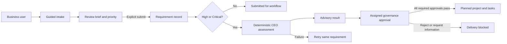
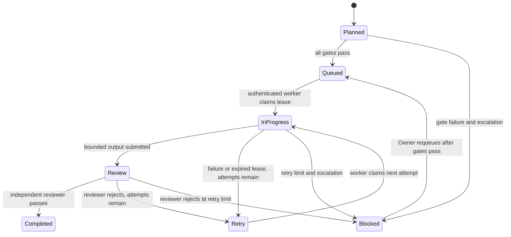

## Requirement-To-Delivery Workflow

This document describes the current requirement intake slice and the governed target workflow. The application is an MVP; items marked as target are not assumed to be implemented merely because the architecture expects them.

### Current MVP path

1. Business user opens the guided intake at `/static/requirement-chat.html`.
2. The browser asks one scripted discovery question at a time and acknowledges which brief section received the answer.
3. Keyword rules may add integration or sensitive-data follow-up questions. The current browser flow is not an LLM.
4. User reviews the generated brief, selects priority, and explicitly submits.
5. Browser posts the brief to `POST /requirements`.
6. Low/Medium requirements remain submitted for the current workflow. High/Critical requirements are saved and then sent to `POST /requirements/{id}/assess`.
7. The current deterministic assessment returns advisory output. If assessment fails, the saved record remains and the UI allows retry against the same ID.

### Target governed workflow

1. Resolve authenticated user, company, and permissions on the server; create an expiring, tenant-scoped intake session.
2. Discover business problem, measurable outcomes, stakeholders, systems/data, security/privacy, constraints, timing, and dependencies. Ask contextual clarifiers and preserve uncertainty as open questions.
3. Present a structured brief and require explicit user confirmation before creating the requirement.
4. Persist the requirement, correlation ID, authenticated actor, tenant, and audit event idempotently.
5. Run versioned CEO business assessment. Then run CTO architecture/security/integration assessment, CFO cost/ROI/budget assessment, and COO timeline/capacity/resource assessment through independently attributable, schema-validated workflow stages.
6. Policy engine calculates review gates from risk class and impact. High-risk/security, governance, budget exceptions, agent lifecycle, organizational changes, and strategic reprioritization require authorized Owner approval.
7. Approval actions are separate human decisions with assigned approver, reason, timestamp, and audit event. AI agents may recommend but cannot approve.
8. After every approval in the active MVP stage is approved, the Project Factory creates a planned project and tasks idempotently; execution/deployment remains separately gated.
9. Track delivery outcomes, risks, costs, capacity, and escalation events through company-scoped services and display them in the executive command center.

### State and control rules

- Request priority, assessed risk, approval state, and delivery status are separate values.
- The tracker verifies persisted approval rows and assignment; a `PendingApproval` label alone is not presented as proof of a decision.
- Assessment failure does not erase an already-saved requirement; retry by ID and preserve assessment version history.
- Rejection or information request must stop downstream project activation until a valid next transition occurs.
- Every critical state transition records actor, timestamp, correlation ID, from/to state, decision rationale, evidence reference, and outcome.
- Tenant checks and approval authority are enforced in backend services, never by UI visibility alone.

### Access and pending-approval notifications

- `USER` sees requests they submitted.
- `MANAGER` sees their own requests and requests from active users explicitly assigned to them through `AppUser.ManagerUserID`. Team visibility is server-filtered and must not be inferred from a department name.
- `ADMIN` can see company request flows and pending-approval status. `ADMIN` visibility does not itself grant authority to approve Owner-reserved decisions.
- `OWNER` / `SUPER_ADMIN` can see all current company request flows and hold the designated critical approval authority.
- Every created pending CEO-review approval produces durable in-app notifications for active Owner/Super Admin governance approvers. Requesters receive an in-app notice on rejection or information request and a notice after final approval. Sensitive request descriptions are not included in notification previews.
- Notifications have an in-app inbox/read state and correlation ID. External email/mobile/push delivery and SLA escalation remain future work.

### Approval completion and automatic continuation

After a valid human approval, the workflow engine should enqueue the next eligible stage exactly once. Before advancing, it must verify that every required approval for the current gate is approved, the approval's expected record version still matches, and no rejection, information request, security hold, or policy block exists. A rejected or information-requested approval stops downstream work. Approval alone never bypasses later deployment/security gates.

**Implemented MVP behavior:** human-review-required CEO assessments create a pending CEO-review approval and durable in-app notifications for active Owner/Super Admin decision authorities. Decisions require a reason and are limited to the assigned approver or Owner/Super Admin. Decisions serialize on the requirement row. After the final pending approval is approved, the requirement becomes `Approved`, and the Project Factory idempotently creates one `Planned` project plus seven `Planned` tasks. Rejection sets the requirement to `Rejected` and does not create a project; an information request sets `InformationRequired` and also blocks continuation. Project/task creation and approval changes share one SQL transaction.

**Still future work:** configurable multi-stage approval policies, email/mobile/push delivery, SLA escalation, optimistic record-version checks, end-to-end workflow execution IDs/idempotency keys, resource assignment, deployment gates, and automated recovery/retry orchestration. Do not describe planned projects/tasks as active delivery or deployment.

### Delivery Lead, task planning, and workforce requests

The delivery-workforce migration adds original standardized role profiles and position records for Delivery Lead, HR Workforce Coordinator, Business Analyst, Software Developer, QA Engineer, Database Administrator, Data Engineer, Data Analyst, and Security Engineer. Once a project is planned, the workforce planner maps the seven current task templates to role profiles, records sequence/effort where assessment evidence exists, and adds finish-to-start dependencies. It auto-assigns only Active non-executive agents whose recorded skills meet every profile threshold and whose task capacity is available.

If a required role has no qualified capacity, the planner creates one pending workforce requisition per project/role and sends a minimal in-app governance notice. The Workforce Center lets Owner/Super Admin authorize recruiting or reject with a reason. Recruiting authorization now automatically creates a role-derived Agent record in `Provisioning`, with Pending skill links. It does not configure the model, verify skills, or activate the agent. Activation is blocked until an approved provider/version is configured and Capability and Safety evaluations pass. After authorized activation, the planner assigns qualified, available agents to tasks and records the Delivery Lead on the project. Task start requires an assigned Active agent, Active Delivery Lead, and completed prerequisites.

The runtime API now provides a governed pull queue, execution leases, bounded retries, output retention with SHA-256, structural checks, independent QA review, defect records, escalation notifications, and audit events. It still does not execute model calls, code changes, or tools: there is no trusted execution adapter or isolated code-edit/test environment, and execution fails closed without one. Task completion requires a separate authenticated reviewer decision after output is submitted. Agent model/provider setup, tool/permission allowlisting, full safety evaluation, independent role/JD approval, HR candidate handling, production calendars, availability/leave, and complete estimates for task roles absent from the assessment are not implemented. Dates remain unset until qualified capacity and an agreed start date exist. Role profiles are original baseline templates, not copied global employer postings.

### Agent runtime queue and review

Apply `sql/12_agent_runtime.sql` followed by `sql/13_agent_runtime_credentials_defects.sql` before enabling runtime routes. The runtime is pull-based; no background worker is started by FastAPI. An Owner/Super Admin may issue or revoke an agent-scoped worker credential only for an Active agent. The raw credential is returned once, while only its SHA-256 hash is stored. Each worker call derives its AgentID from that credential; clients cannot select or impersonate an agent by supplying an ID.

The Owner/Super Admin enqueue endpoint only queues eligible, assigned tasks. Governance, approval, activation, task-scoped high-risk security evidence, active assignment/skills/capacity, Active Delivery Lead, and dependency checks run before queueing and again at claim. Gate failures become Blocked tasks with durable escalations and notifications. A worker claim receives a task snapshot and a ten-minute lease; heartbeats renew the lease. Output, failure reports, and heartbeats are rejected for expired or non-active leases. Retry attempts are bounded (three maximum); exhaustion blocks and escalates the task.

Output structural QA verifies a non-empty name/content and the configured size limit only. It does not run tests, inspect correctness, or establish security. `Completed` is reachable only through the separate authenticated Admin/Owner/Super Admin review endpoint; a reviewer must provide a rationale and cannot be the originating agent. Rejection requires root cause, business/technical impacts, recommendation, priority, and severity, creates a defect assigned to the task role, and retries or escalates. A later independent QA pass closes the task's open remediation defects. These reviewer roles are an initial policy boundary; a dedicated Quality Reviewer role and gate-registry-driven approvals are not yet wired.

Runtime monitoring, escalation listing/resolution, defect listing, lease reaping, task queueing, and review are protected APIs under `/runtime`. An Owner requeue resets a blocked task only inside the transaction, re-runs every execution gate, and commits only if all pass. Runtime events are accompanied by AuditLog entries; escalations create in-app notifications for active Owner/Super Admin accounts. These routes do not start an execution adapter, sandbox, model invocation, or autonomous loop. Configure and independently assess a trusted isolated worker before using credentials for code or tools.

### Target organization and gate registry

Migration `sql/08_governed_organization_and_quality_gates.sql` adds organization metadata to role profiles (`ReportsToRoleCode`, layer, approval scope, quality gates, autonomy ceiling), the executive/department/specialist role catalog, `GovernanceGateProfile`, and `EscalationPolicyProfile`. `/workforce/governance-catalog` exposes this configuration to authenticated company administrators and labels it as not runtime-enforced. This is configuration for the target model, not an active 15-stage workflow. The runtime currently enforces the single CEO approval stage and the staffing/task guards described above; CEO/CTO/CFO/COO orchestration, independent QA stages, production gate, timers, and escalation actions are future implementation work.

Migration `sql/10_organization_bootstrap.sql` adds the missing department-head profiles, Agent role binding, and a unique company bootstrap ledger. On a final approved Owner/Super Admin decision, Project Factory invokes the organization orchestrator in the same transaction. It creates missing departments/positions, reuses existing mapped role agents, creates a non-active `Provisioning` Agent for each remaining active role profile, adds Pending skill links, and applies the reporting hierarchy. Retries are idempotent and may reconcile newly added role profiles. Existing active governance agents are reused and preserved. This fulfills organization-record generation only; it does not activate agents, configure providers, or start execution.

Migration `sql/11_agent_activation_governance.sql` adds provider metadata and durable activation blockers. Activation now requires an approved provider plus model/version, passed Capability/Safety/Security/Governance evaluations, and an explicit reasoned Owner/Super Admin action. Failed checks persist blockers, audit the attempt, and notify governance users. The Workforce Center surfaces those blockers; no unverified result is treated as a pass.

Runtime persistence is added by `sql/12_agent_runtime.sql`; per-agent hashed worker credentials are added by `sql/13_agent_runtime_credentials_defects.sql`. Runtime routes are implemented, but the queue has no built-in execution worker or code sandbox. Only the governed lifecycle and output/review records are available until a trusted adapter is deployed and tested.

### Future voice assistant and voice approvals

Voice may later support hands-free status inquiries and guided requirement intake. Voice-driven approval is disabled until speaker identity is authenticated, step-up MFA is performed, the exact approval scope/amount/risk is read back for confirmation, replay/deepfake defenses are reviewed, and an immutable transcript/evidence reference is retained under an approved privacy policy. A spoken utterance or AI-generated voice match alone must never authorize a consequential decision. Provide a non-voice approval alternative and accessibility fallback.

For requirement intake UX, API contracts, data model, controls, and the AI CEO prompt contract, see [Requirement Management](Requirement_Management.md). For end-user setup and usage, see the [Step-by-Step Guide](../STEP_BY_STEP_GUIDE.md).
